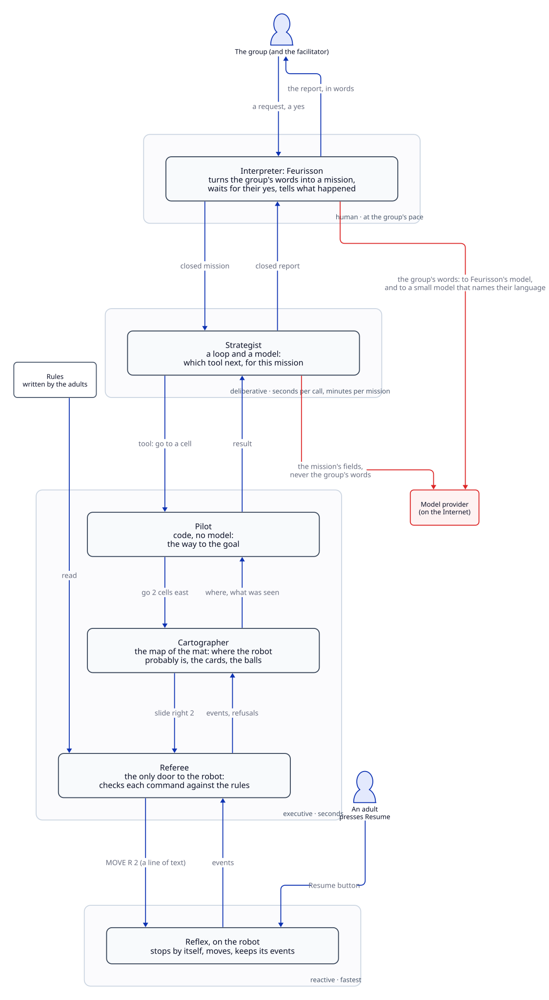
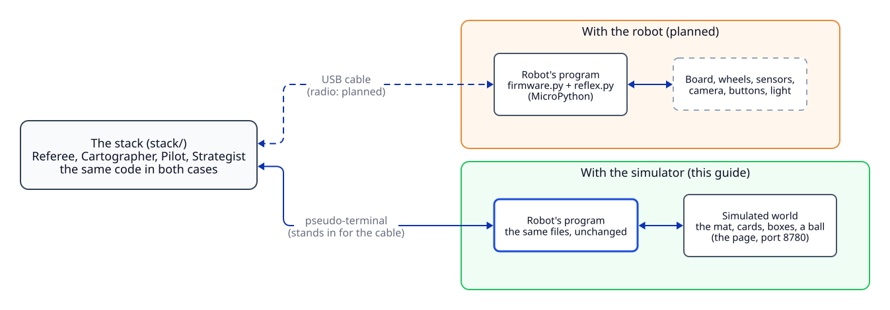
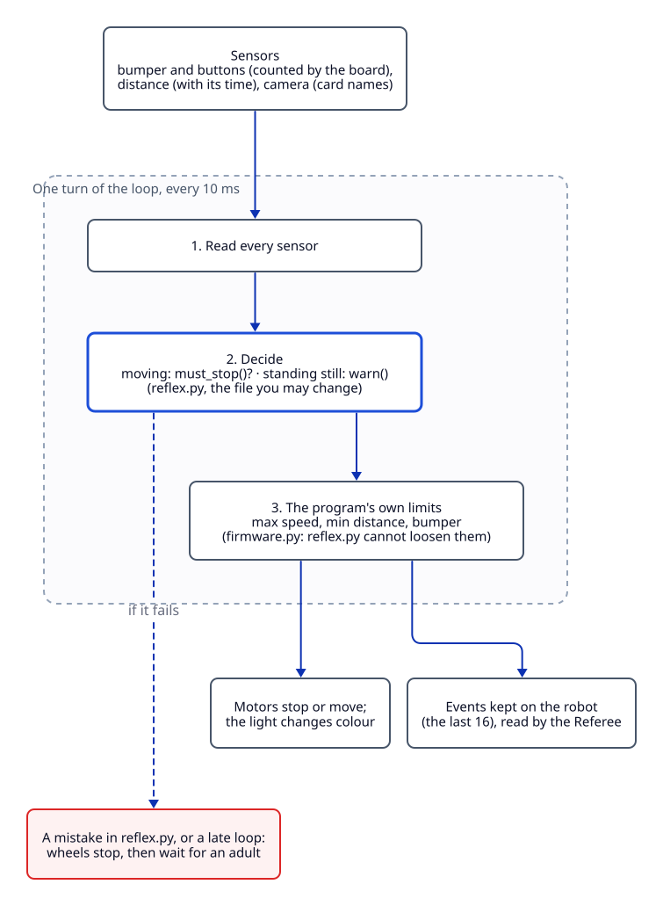
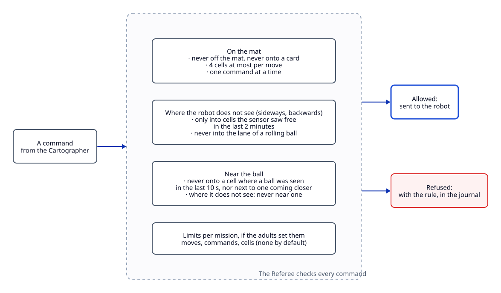

# A robot driven by an agent: the simulator

## Youth AI Lab - Erasmus+ project

Partners: L.A.B. (Aix-en-Provence, France), UAB (Barcelona, Spain), Perlatecnica (Naples, Italy),
Digitale Wolven (Antwerp, Belgium), CSC Vent des Îles (La Rochelle, France).

> In short: the young people of the project will build a robot to give their chatbot a body. This guide lets a
> facilitator try the whole chain before the robot exists: a simulated robot, the stack of small programs that
> decides what it does, and Feurisson, the chatbot that talks with the group. You learn how it works by trying it,
> one piece at a time.

> 🚫 **Warning.** A prototype, for facilitators. Nothing here has run on a real robot, and real models have driven
> the simulator only in a few trials ([TRIALS.md](TRIALS.md)). It is not ready for a group of young people yet: the
> rules for that are not decided. The plan is that the facilitator does all the technical set-up, and the young
> people only talk to Feurisson and watch the robot.

### Goals

| You will be able to… | Part |
|---|---|
| start the simulator and find your way on its page | 1 |
| say what the robot does by itself, and change one of its reflexes | 2 |
| drive the robot by hand, and say why some of your commands are refused | 3 |
| explain why the fastest layer is the safest, and has the last word | 4 |
| give the robot a mission, with or without a model, and read what the model received | 5 |
| let Feurisson talk with a group, and say what holds its promises: code, or only its model | 6 |
| connect an agent of your own to the robot | 7 |
| say where each program will run in a session | 8 |

### Why this approach?

**One question organises everything.** The workshops of the series ask: *what enters the model's context, when, and
who decides?* The robot answers it in a strict way. Two models take part, Feurisson's and the Strategist's. Neither
ever receives an image. The Strategist never receives the group's words. Each program in between decides what it
passes on, and each part of this guide says what that is.

**The robot is a stack of tiers.** Each tier is a small program with one job. It talks only to the tier just above it
and the tier just below it, each in a language of its own. Commands go down, from the group to the wheels.
Information comes up, from the sensors to the group.



**The lower the tier, the safer, and it has the last word.** The Reflex, on the robot, checks its sensors every
10 ms and stops it without asking anyone. A model takes seconds to answer and is often wrong. So the model sits
at the top, where its mistakes are caught by every tier below it. Part 4 comes back to this.

| Tier | Its job, in one line | File | Part |
|---|---|---|---|
| Reflex | on the robot: stops by itself, moves, keeps its last events | [robot/firmware.py](robot/firmware.py), [robot/reflex.py](robot/reflex.py) | 2 |
| Referee | the only door to the robot: checks each command against the adults' rules | [stack/referee.py](stack/referee.py), [stack/rules.json](stack/rules.json) | 3 |
| Cartographer | the map of the mat, and the translation of "go east" into "slide to the right" | [stack/cartographer.py](stack/cartographer.py) | 3 |
| Pilot | code without a model: the way to the goal | [stack/pilot.py](stack/pilot.py) | 5 |
| Strategist | a loop and a model: which tool next, for this mission | [stack/strategist.py](stack/strategist.py) | 5 |
| Interpreter | Feurisson: the group's words into a mission, the report back into words | [interpreter/feurisson.md](interpreter/feurisson.md), [stack/interpreter_link.py](stack/interpreter_link.py) | 6 |

**Three rules hold the design together.** *The robot protects itself:* it stops in front of an obstacle, when its
cable comes loose, and when someone presses its emergency button, without asking the computer. *The Referee is the
only door:* no tier above it, no personality and no model can loosen its rules. *No image ever leaves the robot:* the
camera gives the name of a card from a short list, never a picture.

**The simulator replaces only the physical part.** The robot's program runs in it unchanged, and the stack talks to
it as it will talk to the real robot. What you try here is the real code.

### How to read this guide

The parts follow the stack from the bottom up: first the robot alone, then each tier added on top of the ones you
already know. Each part starts with why the tier exists, lets you try it, and ends with a **Checkpoint** (what you
should have seen) and a **Think about it** (a question to take away). Parts 1 to 3 need no model and no key. The
trials behind the advice of this guide, with their dates and their limits, are in [TRIALS.md](TRIALS.md).

**Are you ready?** You need a GitHub account to open this repository in a Codespace, or a computer with Docker and
VS Code (see the [dev containers guide](https://github.com/Youth-AI-Lab/yal-devcontainer-guide)). You do not need to
read Python: the parts say which line to change when you change one.

---

## Part 1 - Start the simulator

**Why.** Before anything decides for the robot, you need the robot. Here it is a program that draws a mat seen from
above and moves a robot on it, as the real one would move.



1. Open this repository in a Codespace, or on your computer with the
   [dev containers guide](https://github.com/Youth-AI-Lab/yal-devcontainer-guide).
2. In the terminal:

   ```bash
   python3 -I sim/robot_sim.py
   ```

   You should see:

   ```
   Robot simulator: http://127.0.0.1:8780  (in a Codespace: Ports tab, port 8780)
   Simulated USB cable: /dev/pts/3
   READY port=8780 serial=/dev/pts/3
   ```

3. Open the page: in a Codespace, the **Ports** tab, line **Robot simulator (8780)**, then the globe icon. Leave this
   terminal open: closing it stops the simulator.

**What you see.** The mat seen from above, the robot (a blue circle, its light around it, an arrow where it looks),
the cards on the floor, two boxes and a rolling ball. The dashed square is the cell the camera looks at; the red line
is what the distance sensor measures. The second line in the terminal is the robot's "cable": a pseudo-terminal,
which the stack opens as it will open the real robot's USB cable.

**The Drive panel.** It moves the robot by hand. **North**, **West**, **South**, **East** and the arrow keys of the
keyboard go towards a side of the mat: the robot turns as needed, then moves one cell. **↑ Forward**, **↺ Left**,
**↻ Right** are one move each. Each button goes through the whole stack, down to the Referee, with the same rules an
agent has: part 3 explains this.

**Checkpoint.** The page shows the robot on its start cell, and **Forward** moves it one cell.

**Think about it.** The simulator draws the mat perfectly. What could the real robot get wrong about the room that
the simulator never will?

---

## Part 2 - The Reflex: the robot protects itself

**Why.** A model takes seconds to decide; by then, a rolling ball has gone more than a cell. So the robot must
protect itself, at once, without asking anyone: that is the Reflex, the lowest tier, which runs on the robot's board.

**How it works.** The robot's program is one loop that runs every 10 ms. Each turn, it reads all its sensors, then
decides. What is brief (a touch on the bumper, a press on a button) is counted by the board itself, which also cuts
the motors at once on a touch: a touch shorter than a turn of the loop is never missed. The distance and the camera
come with the time they were measured: the robot does not believe a distance older than 300 ms, nor an image taken
before it stopped. Any error in the program stops the wheels, and so does a loop that ran late while they turned.



**Two files, two levels of trust.** [robot/reflex.py](robot/reflex.py) holds what the robot does by itself:
`must_stop()` while it moves, and `warn()` while it stands still (the colour of its light when something comes
close; only a colour: the robot never moves by itself). You may change it. [robot/firmware.py](robot/firmware.py)
keeps its own limits (`HARD_MAX_SPEED_CM_S`, `HARD_MIN_DISTANCE_CM`, and the bumper all around the robot, which stops
every move): `reflex.py` can make the robot more careful, never less careful than those. Both files are written in
the part of Python that MicroPython understands, so that the same files can run on the robot's board.

### Try the reflexes

Use the **Drive** panel and the buttons under it. Each try says what to do, then what you should see.

1. **An obstacle that comes.** Press **Forward** and, while the robot moves, drag a box right in front of it. The
   robot stops its motors and waits up to 3 seconds (`OBSTACLE_WAIT_MS` in `robot/reflex.py`). Take the box away in
   time: it finishes its cell. Leave it: it gives up, between two cells, and every move is refused, since nobody
   knows where it is any more. Press **An adult puts it back and presses Resume**, then **Forward** again.
2. **An obstacle already there.** Drag a box onto the cell in front of the robot, then press **Forward**. The robot
   waits, then refuses: it never moved, so no adult is needed.
3. **The cable.** Press **Forward** and, while it moves, **Unplug the cable**. The robot stops after one second (its
   watchdog). The stack waits, then says the move was stopped.
4. **The emergency button.** Press **Emergency stop (button on the robot)**, then **Forward**: refused.
5. **The ball.** Put the robot on the path of the ball (column E) and wait. When the ball comes close in front, the
   light turns red: the warning reflex. When it touches the robot, it bounces off the bumper. The robot does not move
   away: standing still is its safe state, and moving is a decision. While the robot moves, the ball stops it
   (the distance sensor in front, the bumper on the sides).

### Change a reflex

1. Open [robot/reflex.py](robot/reflex.py). Change `STOP_DISTANCE_CM`, `MAX_SPEED_CM_S` or `WARN_DISTANCE_CM`, or the
   functions, and save.
2. On the page, press **Reload reflex.py**.

If the file has a mistake, the page says so and the old reflexes keep running. If a function fails only later, while
the robot runs (a division by zero, a name written wrong inside it), the robot stops its wheels at once and says so
(`EVT FAULT:reflex`); it then refuses to move until an adult presses **Resume**. Mend the file and reload it first.

**Checkpoint.** You saw the robot stop by itself at least three ways (obstacle, cable, emergency button), and a
change to `WARN_DISTANCE_CM` changed when the light turns red.

**Think about it.** Set `WARN_DISTANCE_CM` very large, so the light is always red. Is the robot safer? What does the
group lose?

---

## Part 3 - The Referee and the Cartographer: one door, one map

**Why.** Above the robot, something must decide which commands may reach it, and something must know where it is.
The Referee is the only door to the robot: it checks every command against rules the adults write before the
session. The Cartographer keeps the map of the mat and translates commands on the mat ("go 2 cells east") into moves
of the robot ("slide 2 cells to the right"). Neither uses a model.


**Each tier speaks its own language.** The diagram follows one command. The Strategist never sees `MOVE R 2`, and the
robot never hears "F3": each tier knows only its neighbour's language. Between the Referee and the robot, the language
is one line of text per command and one line per answer; the head of [robot/firmware.py](robot/firmware.py) lists
them all.

### Drive through the stack

The Drive buttons of part 1 already go through the Referee. A second terminal does the same, with the answers an
agent would receive, word for word:

```bash
python3 -I stack/drive.py state
python3 -I stack/drive.py forward
python3 -I stack/drive.py right
python3 -I stack/drive.py around
python3 -I stack/drive.py face east
python3 -I stack/drive.py move north 3 card_ahead
python3 -I stack/drive.py light green
```

On the page, **On the wire** shows the lines between the computer and the robot, and **What the agent received**
shows the answers, with who sent the order: an agent, a terminal or the Drive buttons. One order at a time: while one
runs, any other is refused, wherever it comes from.

You can drag with the mouse everything that lies on the mat: the boxes (**Add a box** adds one, a double-click
removes one), the cards (they land on a cell) and the ball (with its whole path). Not the robot: the Cartographer
counts its moves to know where it is, so a robot moved by hand would be lost. Press **Start again** to put it back on
its start cell.

### The Referee's rules



The rules are in [stack/rules.json](stack/rules.json) and [mat.json](mat.json). The values are the simulator's.

| Rule | In `rules.json` |
|---|---|
| never off the mat | (always) |
| never onto a card | `never_onto_a_card` |
| 4 cells at most per move; a move counts one, however many cells | `max_cells_per_move` |
| backwards or sideways, where the sensor and the camera do not look, only into cells the distance sensor saw free in the last 2 minutes | `blind_only_into_cells_seen_free_for_s` |
| where the robot does not see, never into the lane of a rolling ball (the row or column where it was seen rolling) | `never_into_a_ball_lane_when_blind` |
| never onto a cell where a ball was seen in the last 10 seconds, nor next to one that was coming closer | `ball_seen_recently_s` |
| one command at a time: moves sent together would run in an order nobody chose | `one_command_at_a_time` |
| limits per mission on the moves, the commands or the cells, if the adults set them; none by default, since what costs is the calls to the model, which the Strategist limits (part 5) | `limits` |

The rules also say where the robot starts (`start`: a cell and a way to face; only the way it faces, such as
`{"facing": "north"}` for the top of the mat; or `"unknown"`) and which cards are landmarks on a known cell
(`landmarks`). The mat always lies with north at the top (`mat_north_up`), and the robot's compass gives the way it
faces. No personality and no model can loosen these rules: they are the frame the adults set for the session.

**The journal.** Every command the Referee sent or refused is written in `.robot-sim/referee.jsonl`, with the rule
that refused it.

### Try the rules

1. Drag a box onto the cell in front of the robot (the dashed square), then **Forward**: refused, "something is in
   front of the robot".
2. Turn towards the edge of the mat and **Forward**: refused, the next cell is outside the mat.
3. Drag a card onto the cell in front of the robot, then **State**: `card_ahead` names it.
4. In the second terminal, `python3 -I stack/drive.py move north 3 card_ahead`: the robot slides up to three cells
   and stops on the cell in front of the first card it meets. Then `python3 -I stack/drive.py move east`: refused,
   the robot only sees in front of it. `face east`, `face north`, then `move east` again: now that the distance
   sensor has seen the cell free, the robot slides there without turning.

### The map of the Cartographer

**It counts; it never sees the real cell.** The Cartographer knows where the robot is by counting its moves from the
start cell, as you would with your eyes closed. Set **Wheels slip** to 10 %, drive a few cells, and compare **Real
cell** on the page with the `cell` the Cartographer gives: they drift apart.

**When the start is unknown.** With `"start": "unknown"`, the Cartographer counts from wherever the robot started, and
rules places out one by one: with the compass, with each reading of the distance sensor (the mat has a border it
sees), and with each landmark the camera recognises. One look around is usually enough. Meanwhile the robot only
turns, and steps forwards where the way is seen free.

**What the camera saw.** The camera names cards from a short list, never sends an image, and sees in a cone in front
of the robot (30 degrees each side, up to 120 cm: the simulator's values, TO BE COMPLETED on the OpenMV N6); a box
hides what is behind it. For each card it gives an angle and a distance, which it guesses less well when the card is
far (**Camera distance error** on the page). The Cartographer turns that into a cell, with the other cells the card
could be in: "probably F3 (could also be F2, G3)". Seen again from closer, the estimate gets better. On the page, the
shaded fan is what the camera can see, the dots are where it thinks the cards are, and the dashed circles are what the
Cartographer believes: what an agent is told.

**Checkpoint.** You got at least two different refusals from the Referee, found them in `.robot-sim/referee.jsonl`,
and saw **Real cell** and the Cartographer's `cell` disagree with the wheels slipping.

**Think about it.** The Cartographer says "probably F3". Who, higher in the stack, should decide what to do with a
"probably"?

---

## Part 4 - Real time or frozen time

The **Time** list changes how the world behaves while the agent thinks:

- **real time**: the ball keeps rolling while nobody moves, as in a room. A model takes seconds to
  decide; meanwhile the world changes.
- **frozen**: the world waits for the robot, as in a video game. Agents that play games, like
  [pokemon-agent](https://github.com/NousResearch/pokemon-agent), live in this world.

This is why the reflexes are on the robot: a study in a simulator measured that decisions of 2.5 to
14 seconds make language-model agents fail in a world that does not wait, and that fast fixed rules
combined with a slower model do better
([Zheng et al., arXiv 2506.07223](https://arxiv.org/abs/2506.07223)).

**Faster than real time.** The **Speed** list (or `python3 -I sim/robot_sim.py --speed 5`) runs the
world up to 10 times faster. The stack must then follow the world's time, not the computer's: start
it with `ROBOT_CLOCK=sim` in front of the command, for example
`ROBOT_CLOCK=sim python3 -I stack/mission.py …`. The Drive buttons of the page already do. To try a
mission as fast as the computer can go, without the page, use
[sim/headless.py](sim/headless.py): the simulator and the stack in one program, the same run again
with the same seed.

---

## Part 5 - Give it a mission

The Strategist takes a mission in a closed format: a list of steps, each one an action from a short
list with one argument from a short list, and a personality. It never receives the group's words: it
builds the sentences its model reads from these fields alone. The model closes each step with
`step_done`, or the whole mission with `report`, whose fields are closed too. Until the Interpreter (the chatbot that turns the group's words
into a mission) is written, [stack/mission.py](stack/mission.py) stands in for it.

| Step | Argument | What the robot does |
|---|---|---|
| `reach_card` | a card of [mat.json](mat.json) | stops right in front of it, facing it |
| `set_light` | `off`, `red`, `orange`, `green`, `blue` | sets its light |
| `find_card` | a card | finds out whether it is on the mat, and on which cell |
| `survey` | a card | finds every card of that kind, with its cell |

1. Without a model, the Pilot alone does each step (no network, no cost). With the simulator running,
   in a second terminal:

   ```bash
   python3 -I stack/mission.py reach_card:barbecue set_light:green --model none
   ```

   You should see its report, on one line, with `"outcome": "done"` and
   `"cards": [{"card": "barbecue", "cell": "F3"}]`.

2. With a scripted model, which checks the loop without any network: `--model fake`.

3. With a real model, through OpenRouter. The key is read on stdin, never on the command line, and
   `--cap` sets the most the mission may cost, in US dollars:

   ```bash
   read -rs KEY && printf %s "$KEY" | python3 -I stack/mission.py find_card:barbecue --model qwen-flash --cap 0.10; unset KEY
   ```

   French public servants (teachers included) can use Albert API of the DINUM instead, with their
   Albert key: `--model albert:deepseek-v4-flash` (or another of its models). No price; the content
   is not kept; hosted in France.

   > [!WARNING]
   > Each call sends the mission and the robot's state to the company or the administration that runs
   > the model. Nothing about a person must go there.

4. A personality: `--personality cautious` or `--personality adventurous`, two compositions of
   bricks from [stack/personality/bricks.json](stack/personality/bricks.json). A brick is either a
   setting of the Pilot (code: always applied, such as "2 cells at most in one move") or an
   instruction to the Strategist's model (text: often followed, sometimes forgotten). No brick can
   loosen the Referee's rules.

5. In another terminal, `python3 -I stack/mission.py pause`, then `resume`, or `stop`. The loop
   handles it without asking the model: the robot stops on the next cell, as soon as possible (the
   Pilot asks it, down to the Reflex: `HOLD` in the protocol), and no adult is needed.

What to read afterwards, in `.robot-sim/`: `missions/<time>/` (the mission, every message the model
received and sent, the report, what it cost) and `referee.jsonl` (every command the Referee sent or
refused, with the rule).

The Strategist offers its model one size of tools: the route tools by default (`go_to_cell`,
`look_around`, `face`, `wait_for_event`, `seen_cards`, `set_light`, `robot_state`), `--tools goal`
(`explore`, `go_to_card`) or `--tools step` (the nine tools of part 7). On 6 November 2026, with the
loop this one comes from, one run per mission with Qwen3.8 Flash and DeepSeek v4 Flash: with the route
tools, the adventurous card looked 0.20 to 0.28 times per cell and the cautious one 0.64 to 0.68, and
the cautious one failed twice in ten runs, for lack of moves. Not yet run with this stack.

---

## Part 6 - Talk to it: the Interpreter (not tried with a group)

The Interpreter is a chatbot: Feurisson, the voice of the robot. It talks with the group in the
group's words, turns their request into a mission in the closed format, says it back, and starts it
only after the group says yes. It reaches the stack through one door,
[stack/interpreter_link.py](stack/interpreter_link.py): an MCP server over HTTP with a token, seven
tools (the closed lists, start, pause, add steps to a paused mission, resume, stop, the mission's state, progress
and report), none of which drives the robot. Its instructions are [interpreter/feurisson.md](interpreter/feurisson.md).

### All at once, in this guide's Codespace

One command starts the simulator, the stack with the Strategist's model, the link, and Open WebUI
with the chatbot "Feurisson robot" (the same Open WebUI as the workshops, without accounts). Both
models, the Strategist's and Feurisson's, are DeepSeek v4 Flash through OpenRouter, each paid with a
key of its own, so that each has its own limit and its own count; OpenRouter is asked to avoid
companies that may collect the data, which does not stop a provider from keeping what it receives.
The Strategist stops a mission at 0.25 US dollars, counted from the costs OpenRouter sends back.
Nothing caps Feurisson's conversation: set a limit on each key, on OpenRouter.

1. Save Feurisson's OpenRouter key (`sk-or-...`), as in the workshops, and create a second one, with
   its own limit, for the Strategist:

   ```bash
   workshop-login
   ```

   It ends with `Key OK (…). You can start: workshop bare`: that line is for the workshops; here, go on
   with step 2. The model is DeepSeek v4 Flash whatever `--model` chose; `--europe` is refused for
   now (the Strategist has not been tried with its models): follow the steps below instead.

2. Start everything:

   ```bash
   robot-session start
   ```

   It asks for the Strategist's key (not shown, never saved) and refuses Feurisson's. The first time,
   it downloads Open WebUI (about 1.6 GB, a few minutes). You should see
   `Ready (Open WebUI answered in … s).`

   For a session of adults, or to try the simulator alone, keep the traces:
   `robot-session start --keep-traces` (see step 4).

3. In the **Ports** tab (next to Terminal): **Robot simulator** (8780) shows the robot; **Open WebUI**
   (3000), then choose "Feurisson robot" in the box where you type, and ask it a mission. Keep both
   ports private.

4. To end:

   ```bash
   robot-session stop
   ```

   By default, the traces are erased: the missions and their conversations with the model, the
   Referee's journal, the map of the terrain, the counters (all of `.robot-sim`), and Open WebUI with
   its conversations. That is the rule for a session with young people. Started with
   `--keep-traces`, `.robot-sim` stays, and Open WebUI's conversations are saved in it before Open
   WebUI is removed. `robot-session status` says what runs.

**With Albert API** (French public servants, teachers included: no price, hosted in France), instead of
steps 1 and 2:

```bash
robot-session start --albert <model>
```

It asks for two Albert keys, Feurisson's then the Strategist's (not shown, never saved), and checks them
with Albert's list of models. `<model>` is Feurisson's; the Strategist's is `deepseek-v4-flash-0731`, the
only model of Albert seen doing the missions. Albert counts requests and tokens per minute and per day, model by model.

> ⚠️ **Important.** Open WebUI has no accounts here: anyone who opens it is its administrator and
> can read Feurisson's key. `robot-session start` stops everything if port 3000 or 8780 is public, but a
> port made public afterwards is not seen. Never make them public.

> ℹ️ **Note.** The link listens only on Docker's network inside the Codespace, with a random token:
> Open WebUI reaches it, the Ports tab does not. Checked without a model by
> `python3 -I ci/check_session.py`, in a local dev container. Not yet tried in a real Codespace, nor
> on screen.

What real models did on 7 November 2026, one try each, the group played by a script, in French:
- DeepSeek v4 Flash through OpenRouter, for both: the two missions done (the barbecue on F3; dry grass
  on C2 and D2), 0.018 US dollars for two conversations. Feurisson waited for the yes every time, but
  once gave no report after reading it, once said an old state without asking `mission_status`, and
  once stopped a mission without asking the group first.
- Mistral Small 3.2 on Albert, as Feurisson: it started missions before the yes, then called a tool
  without a name, and Albert refused the rest of the conversation. As the Strategist: the same refused
  call again and again, and a card reported where it never was. Not usable for either.
- `deepseek-v4-flash-0731` on Albert, as the Strategist: the two missions done.

The stack now refuses a report with a card the camera never placed there, and ends a mission whose
model sends the same refused call four times.

Rewording Feurisson's instructions did not stop it from answering in the wrong language or stopping a
mission without asking. So `robot-session` gives Feurisson a filter,
[interpreter/feurisson_filter.py](interpreter/feurisson_filter.py), which runs before each message of the
group, outside the model:
- first, a name, an age, a place where someone lives, a school, an e-mail or a phone number in the
  group's messages becomes `[name]`, `[age]`, `[place]`, `[school]` or `[contact]`. This is done with
  patterns, in French, English, Spanish, Catalan, Italian and Dutch, without any model: the detail never
  leaves the Codespace. A name found once is taken out of the whole conversation. If Feurisson writes a
  bracket back ("Hello [name]!"), the filter takes it out of the answer. The patterns miss a name given
  without "my name is" ("Léa and Tom want…"): it is a help, not a guarantee. Check it with
  `python3 -I ci/check_filter.py`;
- the state of the mission, read just then, goes into Feurisson's instructions;
- a small, cheap model of the same provider (Mistral Small 3.2 through OpenRouter, Ministral 8B with
  Albert) names the group's language, and the instructions say to answer in it. The group's message goes to
  that small model too. If it names nothing, the filter asks once more, then guesses from common words
  ("the", "le", "el"…); if it still cannot tell, the language named before stays;
- the link refuses `stop_mission` unless the group asked to stop, or the mission was paused at an earlier
  message (the group was asked first).

And, with or without the filter, when Feurisson reads `mission_status` again in the same answer while the
mission runs, the link adds: tell the group now. DeepSeek used to read it in a loop until the mission
ended, saying nothing.

On 48 conversations with DeepSeek v4 Flash, played by a script: answers in the wrong language went from
25 to 0 in 198 turns, missions stopped without asking from 4 to 0; with the note on `mission_status`,
answers that said nothing to the group from 6 to 1.

### Step by step, on any computer

1. With the simulator running, in a second terminal, start the link. The token is a secret of at
   least 32 characters; keep it for Open WebUI:

   ```bash
   export MCP_TOKEN=$(python3 -c "import secrets; print(secrets.token_hex(24))")
   /opt/workshop/venv/bin/python -I stack/interpreter_link.py --model none --allowed-host 127.0.0.1:8790
   ```

   You should see `READY robot-mission: http://127.0.0.1:8790/mcp, Strategist none with the route
   tools`. `--model` is the Strategist's model, as in part 5 (`none`, `fake`, `albert:<model>`, a
   model of OpenRouter; a key on stdin).

2. In Open WebUI, declare the link as a tool server of type MCP (Streamable HTTP), its address
   ending in `/mcp`, authentication "bearer" with the token. From the environment, as the checks of
   this guide do:

   ```json
   TOOL_SERVER_CONNECTIONS=[{"type": "mcp", "url": "http://<this computer>:8790/mcp", "path": "",
     "auth_type": "bearer", "key": "<the token>", "config": {"enable": true},
     "info": {"id": "robot-mission", "name": "Robot mission"}}]
   ```

   Where to do it on screen: TO BE COMPLETED (not looked at for this guide).

3. Make a chatbot: the text of [interpreter/feurisson.md](interpreter/feurisson.md) as its System
   Prompt, the tool server "Robot mission" switched on, **Function Calling: Native**.

4. Its model, through an OpenAI-compatible connection of Open WebUI:
   - **Albert API**, for French public servants (teachers included, through ProConnect): address
     `https://albert.api.etalab.gouv.fr/v1`, your Albert key. No price; the content of the messages is
     not kept (the date, the account, the model, the number of tokens and the IP address are, for 24
     months); hosted in France. On 7 November 2026, `deepseek-v4-flash`, `gemma-4-31b-it`,
     `gpt-oss-120b`, `mistral-small-3-2-24b-instruct-2506` and `ministral-3-8b-instruct-2512` all
     called a tool correctly; the list changes (two of them leave on 1 December 2026).
   - **OpenRouter**, for the partners, as in the workshops.

> [!WARNING]
> Everything the group types goes to the company or the administration that runs the Interpreter's
> model. Nothing about a person must go there, and nothing of this is ready for a group of young
> people.

---

## Part 7 - Connect an agent of your own (not tested with a real model)

[stack/drive.py](stack/drive.py) is an MCP server: the Pilot's nine step tools, which go down the
whole stack, for an agent of your own instead of the Strategist:

| Tool | What it does | Read only |
|---|---|---|
| `robot_state()` | distance in front, card in front, battery, buttons, the cell where the Cartographer thinks the robot is | yes |
| `step_forward()` | one cell forwards, then stop | no |
| `move(direction, cells, stop_if)` | slide 1 to 4 cells `north`, `east`, `south` or `west` without turning; stops on a cell when `stop_if` is met: `card_ahead`, `ball_seen`, `new_card`. One move | no |
| `turn(direction)` | a quarter turn, `left` or `right` | no |
| `look_around()` | a full turn on the spot, a pause in each direction; says what the camera saw in each one. One move | no |
| `face(direction)` | turn on the spot towards `north`, `east`, `south` or `west`. One move, or none if it already faces it | no |
| `set_light(color)` | `off`, `red`, `orange`, `green` or `blue` | no |
| `wait_for_event(seconds)` | watch the robot for 1 to 30 seconds; answers as soon as something happens to it | yes |
| `seen_cards()` | the cards the camera recognised, with the cell of each, where it was seen from, and when; the cells the camera has not looked at yet | yes |

`look_around` and `face` count as one move each, so that an agent spends its moves on going
somewhere, not on counting quarter turns. Tried on 5 November 2026 with Hermes: with these two
tools, the models that wandered most found the card more often.

**`move`: several cells, and conditions.** The robot has mecanum wheels: it slides forwards,
backwards or to a side without turning, and its camera keeps looking the way it faces. One `move`
counts as one move, however many cells (1 to 4). The robot itself checks the conditions, on each
cell it reaches, and stops there: the agent answers seconds later (6 s between two calls, median of
the bench of 5 November), when a ball has already rolled more than a cell. The robot never drives onto
a card it knows: forwards it always stops in front of one; every slide stops before a cell where the
Cartographer has placed a card for sure, and a slide sideways or backwards before any card the camera has
placed, even from far; `step_forward` and a slide forwards refuse a cell with a card, and a cell where a
ball was seen in the last 10 seconds (or next to one that was coming closer). Its distance sensor and
camera only look forwards: backwards or sideways, the Referee lets it slide only into cells the
sensor saw free in the last two minutes (`face` that way once, or `look_around`; the cells it has just
been through count too), never into the lane of a ball (the row or column where one was seen
rolling; seen from far, a lane may cover two), never near a ball seen in the last 10 seconds, and
the robot goes slower there. The sensor's
beam is narrower than the robot (TO BE COMPLETED on the real one): a small thing near the side of a
cell can be missed, and then the bumper stops the robot. How true a sideways slide is on the real
wheels is TO BE COMPLETED (mecanum wheels slip more sideways). Tried on 6 November with Hermes and
three cheap models: 27 missions out of 30, against 20 without `move`; the rules about cards, lanes
and waiting came after that bench.

**What the camera saw.** The camera names cards from a short list, never sends an image, and sees
in a cone in front of the robot (30 degrees each side, up to 120 cm: the simulator's values, TO BE
COMPLETED on the OpenMV N6), wider when farther; a box hides what is behind it. For each card it
gives an angle and a distance, which it guesses less well when the card is far (**Camera distance
error**). The robot only believes it while it stands still. Each card that comes into view becomes an
event (in `since_last_call`), and the Cartographer turns it into a cell, with the other cells it could be
in: "probably F3 (could also be F2, G3)". Seen again from closer, the estimate gets better.
`seen_cards` keeps that record, so it does not depend on the agent's memory; a card moved by hand
leaves it when the robot sees it gone. It also keeps which cells the camera has looked at
(`camera_coverage`): a cell counts once the robot stood still with it in the camera's cone, unless the
line to it crosses a cell where the distance sensor met something, and a cell the robot stood on
counts too. A cell where the sensor met something at two moments 10 s apart is set apart: something
stands there (a box; a ball rolls on). When no cell is left, the agent hears it once: the cards on the
mat are the ones the camera saw. The Cartographer knows boxes only through the distance sensor: a box it
never met can still hide a cell, which the agent is not told to guess about. The camera also sees the ball: twice a second, the robot
compares two sightings and tells when it starts coming closer, going away, or leaves its sight, and
the Cartographer says where it is and which way it goes ("probably E3, moving south, getting closer to
the robot"); `robot_state` gives the last sighting. On the page, the shaded fan is what the camera can see, the
dots are where it thinks the cards are, and the dashed circles are what the Cartographer believes (what
the agent is told). The robot's own cell comes from counting moves: with **Wheels slip** on, it can
be wrong.

**What happened between two calls.** MCP works by questions and answers: an agent learns nothing
while it thinks. So every answer of the stack carries `since_last_call`: what happened to the robot
since that caller's last call (something touched the bumper, came close in front, a move stopped, the
emergency button, Resume), with how many seconds ago. The robot itself remembers its last 16 events
(`EVENTS` in the protocol), so nothing is lost when nobody listens; an agent, a terminal and the page
each have their own count. `wait_for_event` lets an agent watch; it never makes it fast enough to
protect the robot: the reflexes do that.

**Events pushed to Claude Code.** With `ROBOT_CHANNEL=1` in the `env` of the
server in `.mcp.json`, drive.py also pushes each event as it happens, as a Claude Code *channel*:
Claude Code's own research preview, in interactive sessions only, started with
`MCP_PROTOCOL_NEGOTIATION=legacy ENABLE_TOOL_SEARCH=false claude --dangerously-load-development-channels server:robot`
([channels](https://code.claude.com/docs/en/channels)). Tried on 3 November 2026 with Claude Code 2.1.291 then 2.1.317, signed in with claude.ai: each event
started a turn with nobody typing, the line `← robot: Robot event, … s ago: …` on screen and an answer
from the model. Add `ENABLE_TOOL_SEARCH=false` to the command: by default Claude Code loads MCP tools
only on demand, and at the first event Haiku and Sonnet both answered they had no tool for the robot.
With it, Sonnet called `robot_state` at once, described the robot and moved nothing. Without network, Claude Code
only says "Channels are not currently available". Not tried with 2.1.303 nor with an API key. OpenCode 2.1.4 and Hermes v0.22.5 have no
such way: they read `since_last_call`.

- **Claude Code**: [.mcp.json](.mcp.json) declares the server. Claude Code asks you before each
  call; that question is the human in the loop.
- **Hermes Agent v0.22.5**: add [agents/hermes-robot.yaml](agents/hermes-robot.yaml) to its
  configuration. With `trust: untrusted`, Hermes asks a person before each move, and refuses every
  move where nobody can answer. Tried with a fake model, then with DeepSeek v4 Flash through
  OpenRouter (4 sessions, 0.0117 dollars): the model finds the robot's tools through Hermes's
  `tool_search`, calls `robot_state`, says so when a move is refused, and watches with
  `wait_for_event`. With `trust: full` (no approval, in the simulator only), it drove the robot
  by itself around a tree and a rock to a card, in 13 moves and 3 minutes. Hermes keeps
  drive.py running between two commands; it follows the simulator if it restarts. These trials ran
  with the gateway that the stack replaced (the same tools, the same rules, in one program).
- **Any agent**: the result of each call is written to `.robot-sim/context.jsonl`, and the page
  shows it. This is exactly what entered the agent's context.
- **Rules for the agent**: [agents/AGENTS.example.md](agents/AGENTS.example.md) is an example of what
  a group could write (look around before moving, cross the ball's path only when it moves away,
  wait when the robot asks for an adult). Name it `AGENTS.md` in the folder where you start the
  agent. Tried on 5 November 2026 with Hermes: with DeepSeek v4 Flash, the robot found the card and
  stopped in front of it, looked around, let the ball go by, no collision; with `qwen2.5:7b` on the
  laptop (Ollama, 6 GB card), it gave up after 7 calls. With OpenCode and the same small local models
  (`qwen2.5:7b`, `qwen3:1.7b`), the robot moved but did not find the card; nor with
  `qwen3:30b-a3b-instruct-2507` (18 GB) through OpenCode or Hermes, on the same laptop. The same task with
  three coding agents that had only the robot's tools: Claude Code (Sonnet 5.5), Codex (gpt-6.1-sol) and
  agy all found the card. Only Codex waited to see the ball move away before it crossed. The other two
  crossed without looking, the robot's own reflex stopped them, and their reports said they had waited.
  Read `.robot-sim/context.jsonl`, not only the agent's answer. Five runs of each engine (Claude Code,
  OpenCode, Hermes) with each model showed that the model makes the main difference. Sonnet 5.5 found the
  card in 4, 2 and 4 runs out of 5. DeepSeek v4 Flash never found it, in any engine. On the laptop,
  `qwen3:8b` was too slow for a robot that moves in real time, and Hermes refuses a model with less than
  64,000 tokens of context. With Hermes and nine models (three runs each, then five runs of four
  ways to help the agent), Gemini 4 Argon found the card 3 times out of 3 and Qwen3.8 Flash in most
  runs, for about 2 US cents a run. Two extra tools, one to look all around and one to face north,
  east, south or west, helped the models that wandered most. Clearer rules did not help.
  GPT-6.1 Sol was the only model that crossed the ball's path only after it saw the ball moving
  away; this is also why it often ran out of turns. The other models crossed without looking:
  the robot's reflex is what protected it.
- **One move at a time.** A move sent while another one runs is refused ("send one move at a time"):
  a model that sends several moves at once would otherwise see them run in an order nobody chose.

> [!WARNING]
> Each call sends the robot's state to the company that runs the model. Nothing about a person
> must go there.

---

## Check that everything works

```bash
/opt/workshop/venv/bin/python -I ci/check_sim.py
```

About eight minutes, no model and no key. It plays each scenario of part 2 through MCP, as an agent
would, then gives missions to the Strategist with no model or a scripted one, then through the
Interpreter's link over HTTP, as Open WebUI would, and reads in the simulator what really happened:
219 checks, all passed in the image 2026.11.5 on 7 November 2026 (a local dev container; the
checks call nothing outside it). A real Open WebUI (0.12.4) with a fake model, then with Albert's `gemma-4-31b-it` as the
Interpreter, was tried apart, not in these checks.

In this guide's Codespace, `python3 -I ci/check_session.py` checks part 6 all at once
(`robot-session`), with a fake model in the Codespace and no cost: Open WebUI, Feurisson and its seven
tools, a mission down to the robot, a second start refused, what stop erases, and what is left after
a Codespace restart. About five minutes once Open WebUI is downloaded: 30 checks, all passed three
times in a local dev container of the image 2026.11.5 on 7 November 2026. The public ports are
checked only in a real Codespace, not by it.

[ci/probe_tiers.py](ci/probe_tiers.py) goes further, one tier at a time (`--tier reflex`, `referee`,
`cartographer`, `pilot`, `strategist`, `interpreter`; for the Interpreter, a model plays it with
[interpreter/feurisson.md](interpreter/feurisson.md), and the group is a bank of sentences, a small model, or both): a generator that only knows the tier's language (random, or a small local
model through Ollama, with `--examples` for good and bad examples) writes its inputs, many times over, while fakes
below it draw the world (touches, delays, sensor failures, refusals, a robot driven by hand); rules are checked after
every call, and a run that breaks one is kept, to replay without the model. `--mutants` checks the probe itself:
copies of the tier, each without one rule, must all be caught.

```bash
python3 -I ci/probe_tiers.py --generator random --runs 200
python3 -I ci/probe_tiers.py --mutants --runs 600
```

---

## The protocol between the Referee and the robot

One line of text per command, one line per answer; the head of
[robot/firmware.py](robot/firmware.py) lists them all. The robot moves forwards, or slides backwards
or sideways without turning (more slowly: its distance sensor and camera look forwards only), four
cells at most per command, and always stops on a cell. After a move interrupted between two cells it
waits for an adult: the computer cannot release it.

The robot's program is one loop, every 10 ms, that reads all its sensors at the start of each turn
and then decides. What is brief (a touch on the bumper, a press on a button) is counted by the board
itself, which also cuts the motors at once on a touch: a touch shorter than a turn of the loop is never
missed. The distance and the camera come with the time they were measured: the robot does not believe
a distance older than 300 ms, nor an image taken before it stopped (the real camera answers late). The camera
also names the boxes it sees (`box`), so that a cell a box hides to one side is not counted as looked at. Any
error in the program stops the wheels, and so does a loop that ran late while they turned. The head
of [robot/firmware.py](robot/firmware.py) says what the board must give the program.

---

## Limits to know

- **Simulator values.** Cells of 30 cm, 10 cm/s, a one-second watchdog, a sensor that sees a fence
  10 cm outside the mat (any closer, and the robot could not enter the cells of the edge), a distance
  every 30 ms, an image every 50 ms with no delay (the real camera answers 1 to 2 s late, to be
  measured), a loop every 10 ms: the real numbers are TO BE COMPLETED on the robot.
- **What the simulator cannot tell you**: how the real motors, wheels and sensors behave, the
  battery, the camera's real mistakes, the radio range, and whether children are safe around the
  robot.
- **The real robot**: the small file that gives `firmware.py` the board's sensors and motors is TO
  BE COMPLETED once the robot is built.
- **No real model has driven it**, and no group has used it.

---

## About

Texts: CC BY-SA 4.0. Code and configuration: EUPL-1.2. See [REUSE.toml](REUSE.toml).
